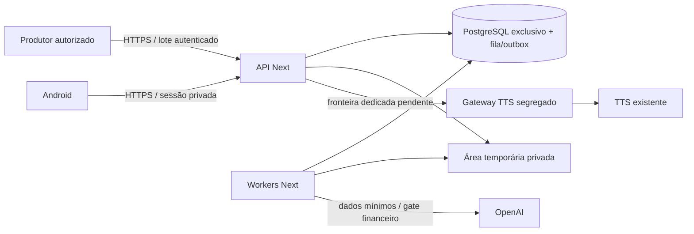

# Arquitetura V1 e fronteiras

Monólito modular Python 3.13, contrato HTTP OpenAPI 3.1/JSON Schema 2020-12.
API e workers compartilham código; PostgreSQL exclusivo guarda catálogo, dados
privados, fila transacional e outbox. A escolha de framework/migration runner será
fechada na 02/03 por compatibilidade com esses contratos; nenhum está instalado.
Android consome HTTPS; Google valida identidade; OpenAI recebe somente insumos
mínimos através de adaptador. Classificação de vaga global, perfil e matching privados.

## Matriz de comunicação planejada

| Origem → destino | Autoridade / protocolo | Gate |
| --- | --- | --- |
| Android → ingresso → API | TLS, sessão derivada do OIDC, autorização por conta | 03; publicação só na 10 |
| Produtor → API | TLS, credencial dedicada, escopo/source allowlist | 04 |
| API/worker → Postgres Next | papéis mínimos distintos, rede privada, sem porta pública | 02/10 |
| API/worker → temporários | handle opaco, tenant verificado, TTL, limite de parser | 06 |
| Backend → Google | hosts de metadados/JWKS aprovados, sem URL arbitrária do cliente | 03 |
| Worker → OpenAI | credencial só no runtime autorizado, sem tráfego em CI | G-AI |
| Next → gateway TTS | identidade exclusiva, escopo síntese/idioma/limite | G-TTS |
| Gateway → TTS existente | caminho mínimo aprovado, sem trânsito genérico | G-TTS |
| CI → dependências | somente instalação por lock; testes sem rede | 01 |

Produção só será implantada na 10, com volumes e backups dedicados.
Workers distribuídos recebem somente testes sintéticos descartáveis. Nenhuma conexão
a bancos, volumes, credenciais ou sessões de outros projetos é permitida.
Isolamento exige autenticação e política de egress, além de redes distintas.
Containers não recebem socket Docker, mounts de segredos de outros serviços ou
acesso a diretórios legados. Endereços e topologia ficam na operação privada.

## Autorização e banco futuro

Tenant vem da sessão validada. Papéis API/worker pessoal não são superuser,
table owner nem BYPASSRLS; usar RLS forçada e contexto transacional com `SET LOCAL`.
Ausência de contexto nega acesso. Reset de pool e testes com os mesmos papéis do
runtime são gates da 02. Worker global só acessa catálogo; tarefa privada contém
escopo verificável e epoch de exclusão. Erro de isolamento nunca vira fallback amplo.

Não há garantia de isolamento SQL implementada na 01: testes atuais verificam
contratos e exemplos, e a prova com Postgres pertence exclusivamente à 02.
